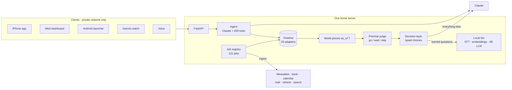

# HAVEN

**A self-hosted personal AI system that I built and operate alone, in development since October 2025 and in daily use.**

HAVEN runs all the time on a laptop-class Ubuntu server in my home. It takes in my
data (wearables, bank feeds, calendar, phone location, car telemetry, mail and notes),
puts all of it on one timeline, and gives a Claude-based agent about 500 tools to read
and act on it. I reach it from a native iPhone app, a web dashboard, an Android
launcher I wrote for my phone, a Garmin watch app, and voice.

The guiding principle is *quiet by default, powerful when invited*. HAVEN acts
on its own only when its judgment says now, and otherwise stays out of the way.

> The source is private because it is full of my own life data. This repo is the
> case study: what it is, how it's built, the problems that were hard, and a few
> excerpts lifted from the real code. The infrastructure side is written up in
> [haven-architecture](https://github.com/havenlabs-dev/haven-architecture).

---

## By the numbers

Counted from the repos on 2026-11-19. The command for each is in [NUMBERS.md](NUMBERS.md).

| | |
|---|---|
| Backend | Python / FastAPI, ~224k lines in `apps/` + ~55k lines of tests |
| Agent tools | 493, across 18 domains |
| API routes | ~900 |
| Database | SQLite (WAL), 427 tables |
| Clients | iPhone (Expo/React Native), web (Next.js), Android launcher (Kotlin/Compose, ~100k lines), Garmin watch (Monkey C) |
| Commits | 2,925 across the backend, four clients and the docs repo |
| Integrations | ~20 (wearables, banking, calendar, mail, vehicle, search, routing, …) |

## Architecture

### The pieces worth knowing about

**One timeline, two clocks.** Every source writes events in one shape, and every
row has two timestamps: `at` (when it happened) and `seen_at` (when HAVEN learned it).
Things that change, like a calendar plan or a charge going from pending to posted, are
stored as keyed revisions. That makes `world.picture(as_of=T)` possible: what HAVEN
*knew* at any past moment. The same call powers the live judge and replays of real
days in tests. → [`excerpts/timeline.py`](excerpts/timeline.py)

**Typed decisions, not generations.** Small choices (categorize this charge, answer this
mail now or later) are asked as a fixed schema: an enum of options plus `other`, a
confidence and a short reason. Anything below the threshold isn't acted on, and every
call is logged. This replaced free-text verdicts parsed with regexes.
→ [`excerpts/decide.py`](excerpts/decide.py)

**A local model has to earn each question.** A 4B model (Qwen3.5 on llama.cpp, CPU only)
shadows Claude on every decision. Each night, per question, HAVEN computes the lowest
confidence threshold at which the local model's agreement with Claude has a **Wilson
lower bound ≥ 0.90**. Only then does that question move local. Nothing is trusted by
default. I picked the model by replaying 202 real logged decisions instead of trusting a
benchmark: 89% agreement at an 8.2 s median, against 56% for the runner-up.

**A judge instead of rules.** Before HAVEN does something on its own, like warming the
car or sending a push, the actor asks `premise.check()` for go / wait / skip against the
live world picture. An unsure answer turns into a short hold, since that's the cheaper
mistake. The old rule's answer is logged next to the verdict, and the rule is deleted once
the record shows the judge does better.

**A local tier on a 15 W budget.** Speech-to-text (Parakeet-TDT 0.6B, real-time factor
0.08–0.14 with diarization), embeddings (Qwen3-Embedding 0.6B, int8) and the 4B LLM all run
on a laptop CPU under a hard power cap. One heavy job runs at a time under an `flock`
lease. Interactive callers don't wait for it; they fall back to the cloud.
→ [`excerpts/compute_lease.py`](excerpts/compute_lease.py)

## Hard problems, and what fixed them

Each of these was a real failure in daily use. I've written them as problem → cause → fix.

1. **Chat replies vanished when the phone dropped its connection.** Turns were tied to the
   SSE request, so a disconnect killed the turn or left it as a zombie. **Fix:** each turn
   runs in its own task with a per-session replay buffer. A retry re-attaches to the turn
   that's still running, and finished turns are kept for 180 s so a late client still
   gets its reply.

2. **Health data stopped arriving for four days, and it looked like an auth failure.** The
   cause was in the database pool: when an abandoned context manager was garbage-collected,
   its `finally` returned a *closed* connection to the pool. **Fix:** closed connections are
   never served or re-pooled. Later, all 448 direct `sqlite3.connect` calls (in 264 files)
   were replaced with one DB door. A test now fails the build on any connect outside it.

3. **My uncommitted edits kept vanishing across restarts.** The process manager's
   `stop_all()` unpacked a `(pid, script, log)` tuple in the wrong order and deleted
   *scripts*. The monitor then restored them from git HEAD. **Fix:** a one-line ordering
   bug, found by following the restarts themselves instead of the edits.

4. **Tests could touch the live database.** One suite read real bills, and another wrote
   a fake one into my actual list. **Fix:** the DB path is defined in one module, which
   215 modules were rewritten to use. The test bootstrap points it at an empty file per
   process and raises if anything reaches a live database.

5. **Several AI coding sessions share one server.** They could restart the backend in
   the middle of each other's work. **Fix:** one restart path. It takes a cross-session
   lock, refuses while a chat is live, runs a canary, and replays every GET a client
   reads, naming any client a response-shape change would break.

6. **The agent satisficed.** Answers were shallow because `max_turns=8` made stopping early
   the rational move. **Fix:** a grounding contract, a 20-turn budget, and truncation that
   always tells the agent how much is missing and which call returns the rest.

## How it's built

I build HAVEN with AI coding agents (Claude Code) and work as the architect and reviewer.
That only works with guardrails: one documented restart path, commits scoped to explicit
paths because sessions share a working tree, a test gate that can't touch real data, and a
standing rule that a check which can't fail isn't a check. More on this in
[haven-architecture → AI-assisted development](https://github.com/havenlabs-dev/haven-architecture/blob/main/docs/ai-assisted-development.md).

## Stack

Python 3 · FastAPI · SQLite (WAL) · Claude Agent SDK / MCP · llama.cpp · sherpa-onnx ·
ONNX Runtime · Next.js · React Native / Expo · Kotlin / Jetpack Compose · Monkey C ·
systemd · Docker · Tailscale

---

*Built by [Aniken Nielson](https://github.com/havenlabs-dev) under HavenLabs.*
